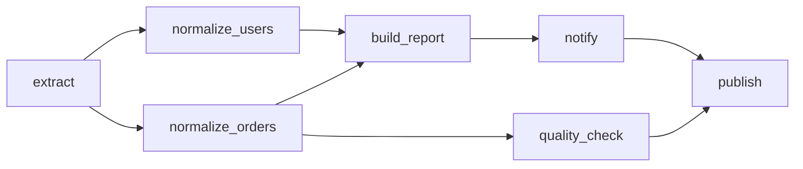
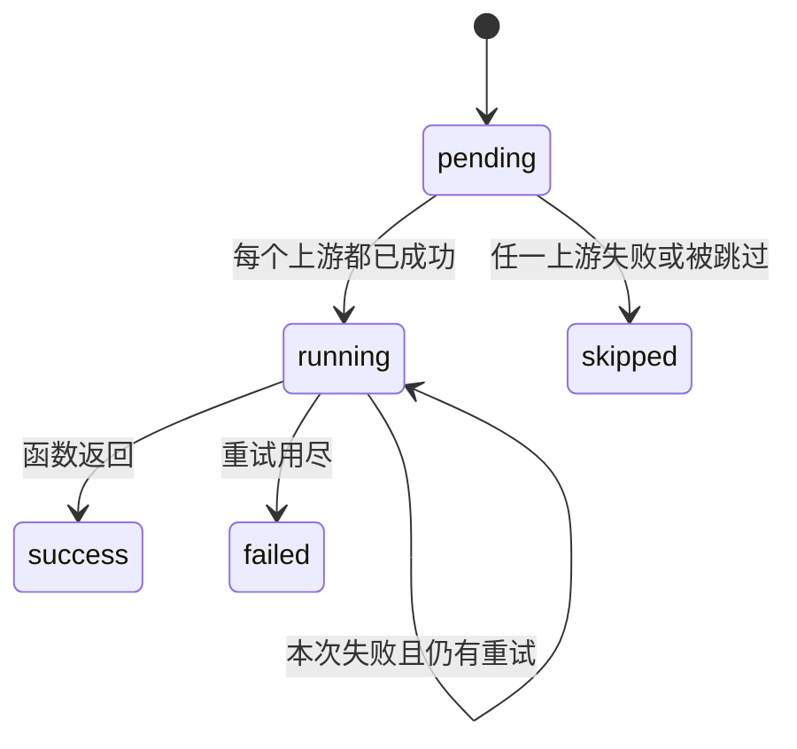

# DAG 的含义和调度框架

这个目录里的 `dag` 包是一个不依赖第三方库的进程内调度器，用来说明 DAG 是什么，以及一个调度框架怎样把图跑起来。

## DAG 是什么

DAG 是 **有向无环图**（Directed Acyclic Graph）。

- **图**：一组节点，加上节点之间的边。在调度里，节点是任务，边是依赖。
- **有向**：边有方向。`extract -> normalize_users` 表示 `normalize_users` 要等 `extract` 成功，并使用它的返回值。
- **无环**：从任一节点出发，沿着边走不回起点。有环就没有合法的执行顺序，例如「A 等 B、B 等 A」。

一条边只约束它连接的两个任务。没有边相连的任务可以同时跑。销售流水线是这样的：



`normalize_users` 和 `normalize_orders` 都只依赖 `extract`，所以它们可以并行。`quality_check` 只依赖订单分支，用户分支还在跑的时候它就可以开始。`publish` 要同时拿到通知和质量检查的结果，所以它排在两边都完成之后。

## 框架分成哪几层

| 层 | 代码 | 职责 |
| --- | --- | --- |
| 任务 | `Task` | 一个可调用对象、重试次数、上游和下游 |
| 图 | `DAG` | 登记任务、用 `>>` 声明边、检查无环、算出拓扑分层 |
| 调度器 | `Scheduler` | 找就绪任务、用线程池执行、传递上游结果、处理失败 |
| 运行结果 | `RunReport` | 每个任务的状态、返回值、异常、事件时间线 |

声明一条流水线只需要函数和边：

```python
from dag import DAG, Scheduler

dag = DAG("hello")

@dag.task
def load(_upstream):
    return [1, 2, 3]

@dag.task
def total(upstream):
    return sum(upstream["load"])

load >> total

report = Scheduler().run(dag)
print(report.values["total"])  # 6
```

`>>` 和 Airflow 一样表示依赖。`a >> [b, c]` 是扇出，`[b, c] >> d` 是扇入，`a >> [b, c] >> d` 可以连着写。重复声明同一条边只会保留一次。

下游函数收到的 `upstream` 是一个字典，键是**直接父任务**的 id，值是父任务的返回值。父任务的父任务不会自动出现在这个字典里；需要的话由中间任务自己带下去。

## 任务状态

每个任务在一次运行里处于下面一种状态：



- `pending`：还不能跑，或者还没排上线程。
- `running`：函数正在执行。
- `success`：返回值已经写入结果，子任务可以读它。
- `failed`：最后一次尝试抛了异常。
- `skipped`：因为上游失败，这个任务不会再被调用。跳过会沿着下游继续传，孙任务也会被跳过。

和失败任务没有依赖关系的分支继续执行。演示里 `--fail-check` 会让 `quality_check` 失败，于是 `publish` 被跳过，而 `build_report` 和 `notify` 仍然成功。

## 调度算法

运行前先用 Kahn 算法做两件事：确认图里没有环，并给出一组拓扑分层。

1. 入度（上游个数）为 0 的任务放进第 0 层。
2. 去掉这一层任务的出边，新变成入度 0 的任务放进下一层。
3. 如果结束时还有任务没进任何一层，这些任务落在环上，或者只能穿过环才能到达，抛出 `CycleError`。环上的函数不会被调用。

同一层里的任务互不依赖。如果调度器按层批量执行，就要等整层结束才开始下一层。本实现用的是更细的规则：

> 一个任务在自己的全部父任务成功之后立刻开始，空闲的 worker 槽位够用就提交。

因此 `quality_check` 可以和仍在运行的 `normalize_users` 重叠。拓扑分层仍然放在 `RunReport.levels` 里，用来说明一种合法的批量顺序；真正的执行顺序看 `RunReport.events`。

线程数由 `Scheduler(max_workers=...)` 限制。同一时刻就绪的任务按 task id 排序后占槽，所以在 `max_workers=1` 时，多个根任务的启动顺序是稳定的。有依赖时，父任务一定先于子任务启动。

复杂度是 O(V + E)：每个任务、每条边在拓扑排序和就绪判断里各处理有限次。

## 失败和重试

`@dag.task(retries=2)` 表示失败后最多再试 2 次，一共 3 次调用。只有抛出 `Exception` 才算失败并重试。重试耗尽后任务记为 `failed`，调度器接着跳过它的全部后代，并继续调度其他就绪任务。

一次运行结束时：

- `report.succeeded`：每个任务都是 `success`。空图也算成功。
- `report.failed`：至少有一个任务是 `failed`。被跳过的任务不会单独让 `failed` 为真，但跳过只会发生在已经有失败的时候。
- `report.values` 只包含成功任务的返回值。
- `report.errors` 只包含失败任务的异常对象。

## 和常见工作流引擎的对应关系

这是一个教学用的单进程调度器，用来把上面的机制跑通。生产系统里的持久化、队列、分布式 worker 不在这个 demo 里。

| 这里 | Airflow 里相近的概念 |
| --- | --- |
| `Task` | Task / Operator |
| `DAG` | DAG |
| `upstream` 字典 | XCom，只传递直接上游的返回值 |
| `Scheduler(max_workers=n)` | LocalExecutor 的并行度 |
| 上游失败则跳过后代 | 默认 `all_success`，失败上游会使下游被 skip |

## 运行 demo

```bash
python3 -m dag
python3 -m dag --fail-check
python3 -m dag --workers 1 --delay 0
```

默认会给任务加一小段睡眠，方便在时间线里看到并行。`--delay 0` 立即跑完。`--fail-check` 让质量检查失败，进程退出码为 1。

输出分四段：

1. 边和拓扑分层。
2. 事件日志：`start`、`retry`、`success`、`fail`、`skip`，时间是相对本次运行开始的毫秒。
3. 时间线：`#` 是任务函数正在执行的区间。订单分支上的 `quality_check` 会落在 `normalize_users` 还没结束的区间里。
4. 每个任务的最终状态、尝试次数和返回值。成功时营业额是 `65`（Ada 35，Max 30）。

测试：

```bash
python3 -m unittest discover -s tests -v
```
